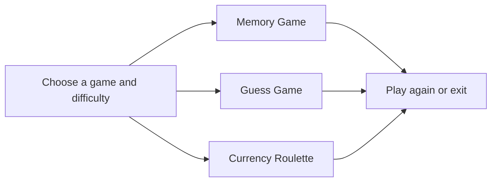

# World of Games · Python console edition

Three terminal games with a shared menu and difficulty selection.





## Run

From the repository directory:

```bash
python3 -m pip install -r requirements
python3 main.py
```

| Game | Challenge |
| --- | --- |
| Memory | Recall a sequence of numbers. |
| Guess | Match the computer's number. |
| Currency Roulette | Estimate a USD amount in ILS. |

## Source map

| File | Purpose |
| --- | --- |
| [main.py](main.py) | Main loop and play-again prompt. |
| [app.py](app.py) | Welcome screen, game selection and difficulty validation. |
| [memory_game.py](memory_game.py) | Memory game. |
| [guess_game.py](guess_game.py) | Number guessing game. |
| [currency_roulette_game.py](currency_roulette_game.py) | Currency game. |
| [requirements](requirements) | Python dependencies. |
